### Data & ML Engineer · Python · SQL · Applied AI

**[ABOUT](#-about-me)** &nbsp; · &nbsp; **[APPROACH](#-engineering-approach)** &nbsp; · &nbsp; **[CONSTELLATION](#-living-project-constellation)** &nbsp; · &nbsp; **[PROJECTS](#-featured-projects)** &nbsp; · &nbsp; **[LAB](#-beyond-the-constellation)** &nbsp; · &nbsp; **[CONNECT](#lets-build-something-meaningful)**

---

## 👋 About me

I'm **Rahul Khanke**, a **Data & ML Engineer** who builds reliable data pipelines and takes machine learning into production, mostly on financial data. I've worked at Sharp Invesco Revolutions and Accenture, with AWS, Azure and Databricks, and hold an MSc in Data Science from the University of Glasgow.

- 💼 **Data Engineer, Sharp Invesco Revolutions** (Dec 2024 – Nov 2026): Python and SQL pipelines on Apache Airflow processing thousands of financial records a day; automation that saved the finance team 5+ hours a week; anomaly-detection, transaction-categorisation and LLM document-extraction models.
- 💼 **Custom Software Engineering Associate, Accenture** (Oct 2022 – Sep 2024): claims-analytics ML services with about 25% better prediction accuracy and about 50% lower latency; Airflow ETL pipelines; Docker, Kubernetes and CI/CD. Employee of the Month twice.
- 💼 **Data Engineering & Machine Learning Intern, Cognizant** (Jan – Apr 2022).
- 🎓 **MSc Data Science**, University of Glasgow; **B.E. Computer Science**, G.H. Raisoni College of Engineering.
- 🧠 Interested in agentic AI, RAG, time-series forecasting, graph analytics, explainable ML and streaming systems.
- 🔎 My case studies distinguish implemented code, optional integrations and demo data.
- 🌐 For detailed case studies, visit [my interactive portfolio](https://portfolio.hulax.uk/).

## 🧭 Engineering approach

> **Start with a real problem. Build with evidence. Make the result useful.**

| 01 · Understand | 02 · Engineer | 03 · Communicate |
| :--- | :--- | :--- |
| Question assumptions, explore the data and define what success means. | Design reliable pipelines, test models, document trade-offs and validate behaviour. | Turn complex systems into understandable interfaces, case studies and reproducible demos. |

I value **clarity over hype**: what works, what is experimental and what still needs infrastructure should always be easy to tell apart.

## ✦ Living Project Constellation

**Four distinct systems. One engineering approach.**

The connections tell the story: **streaming data → intelligent decisions → trustworthy services → human-centered experiences**.

**[Explore the interactive constellation](https://portfolio.hulax.uk/constellation)** · [View its source](https://github.com/HuLaxx/my-portfolio/tree/master/src/app/constellation)

Living visual: a daily GitHub Action is configured to refresh the project signals from public repository metadata. Dates show real repository updates, not simulated activity.

## 🚀 Featured projects

<table>
<tr>
<td width="50%" valign="top">
<h3>🤖 <a href="https://github.com/HuLaxx/Sentinance">Sentinance</a></h3>

<b>AI-powered market intelligence</b> Multi-exchange market streams, LangGraph agents, retrieval-augmented insights and LSTM forecasting.

<code>Python</code> <code>FastAPI</code> <code>LangGraph</code> <code>PyTorch</code> <code>Next.js</code>

<a href="https://github.com/HuLaxx/Sentinance">Explore source</a> · <a href="https://sentinance.hulax.uk">Project website</a>
</td>
<td width="50%" valign="top">
<h3>🛡️ <a href="https://github.com/HuLaxx/GraphGuard">GraphGuard</a></h3>

<b>Explainable fraud analytics</b> Graph-driven fraud detection, XGBoost risk models, SHAP explainability and GraphQL-powered exploration.

<code>Neo4j</code> <code>XGBoost</code> <code>SHAP</code> <code>GraphQL</code> <code>Python</code>

<a href="https://github.com/HuLaxx/GraphGuard">Explore source</a> · <a href="https://graphguard.hulax.uk">Project website</a>
</td>
</tr>
<tr>
<td width="50%" valign="top">
<h3>🚚 <a href="https://github.com/HuLaxx/FleetFlow">FleetFlow</a></h3>

<b>Reactive delivery optimization</b> Vehicle routing with OR-Tools, live fleet visualization and event-driven logistics architecture.

<code>OR-Tools</code> <code>Kafka</code> <code>PostGIS</code> <code>Next.js</code> <code>Python</code>

<a href="https://github.com/HuLaxx/FleetFlow">Explore source</a> · <a href="https://fleetflow.hulax.uk">Project website</a>
</td>
<td width="50%" valign="top">
<h3>🎵 <a href="https://github.com/HuLaxx/Shiftify">Shiftify</a></h3>

<b>Privacy-first music library utility</b> Browser-first YouTube Music export experience with a polished responsive interface.

<code>TypeScript</code> <code>Next.js</code> <code>Tailwind CSS</code>

<a href="https://github.com/HuLaxx/Shiftify">Explore source</a> · <a href="https://shiftify.hulax.uk">Project website</a>
</td>
</tr>
</table>

### 🛰️ Beyond the constellation

*The smaller builds, earlier experiments and ideas that shaped how I engineer today.*

<table>
<tr>
<td width="50%" valign="top">
  05 / CREATIVE ENGINEERING
  <h3>🌐 <a href="https://github.com/HuLaxx/my-portfolio">Interactive Portfolio</a></h3>
  
A personal digital experience featuring 3D visuals, expressive motion, AI-assisted interaction and detailed project case studies.

  
<code>Next.js</code> <code>React</code> <code>Three.js</code>

  <a href="https://github.com/HuLaxx/my-portfolio">Source code</a> · <a href="https://portfolio.hulax.uk/">Visit portfolio ↗</a> · <a href="https://portfolio.hulax.uk/studio">Behind the build ↗</a>
</td>
<td width="50%" valign="top">
  06 / PRODUCT FOUNDATIONS
  <h3>📚 <a href="https://github.com/HuLaxx/Xchange">Xchange</a></h3>
  
An early textbook-exchange prototype. A new functional, local-first marketplace rebuild is being tested before repository publication.

  
<code>React (legacy)</code> <code>Marketplace rebuild</code>

  <a href="https://github.com/HuLaxx/Xchange">Explore repository ↗</a>
</td>
</tr>
<tr>
<td width="50%" valign="top">
  07 / FULL-STACK EXPLORATION
  <h3>🔐 <a href="https://github.com/HuLaxx/TestVeh">TestVeh</a></h3>
  
An earlier Django/React authentication prototype, now being developed into a local-first vehicle-record and registration-review application.

  
<code>Django (legacy)</code> <code>Vehicle registry rebuild</code>

  <a href="https://github.com/HuLaxx/TestVeh">Explore repository ↗</a>
</td>
<td width="50%" valign="top">
  08 / RESEARCH & FOUNDATIONS
  <h3>📉 <a href="https://github.com/HuLaxx/BCPD">BCPD · Regime Shift Lab</a></h3>
  
A working browser-based Bayesian change-point laboratory with time-series import, posterior plots, editable model assumptions and exportable results.

  
<code>Bayesian inference</code> <code>TypeScript</code> <code>Next.js</code> <code>Statistics</code>

  <a href="https://github.com/HuLaxx/BCPD">Explore the source and run locally ↗</a>
</td>
</tr>
</table>

## 🧰 Technical toolkit

| Focus | Technologies |
| --- | --- |
| **Cloud** | AWS, Azure, Databricks |
| **Data engineering** | Python, SQL, Apache Airflow, Apache Spark, Apache Kafka, dbt, PostgreSQL |
| **AI & machine learning** | PyTorch, XGBoost, scikit-learn, SHAP, MLflow, LangGraph, RAG, LSTM |
| **Backend** | FastAPI, GraphQL, Neo4j, Redis |
| **Infrastructure** | Docker, Kubernetes, Terraform, CI/CD, observability |
| **Web** | Next.js, React, TypeScript, Tailwind CSS, Three.js |

---

### Let's build something meaningful

Interested in **applied AI, data platforms or thoughtful digital products**?

[**Portfolio**](https://portfolio.hulax.uk/) · [**LinkedIn**](https://www.linkedin.com/in/rahulkhanke/) · [**Email**](mailto:rahulkhanke786@gmail.com)

Made with curiosity, code and attention to detail.

