### AI Engineer · Data Scientist · Full-Stack Engineer

**[ABOUT](#-about-me)** &nbsp; · &nbsp; **[APPROACH](#-engineering-approach)** &nbsp; · &nbsp; **[CONSTELLATION](#-living-project-constellation)** &nbsp; · &nbsp; **[PROJECTS](#-featured-projects)** &nbsp; · &nbsp; **[LAB](#-beyond-the-constellation)** &nbsp; · &nbsp; **[CONNECT](#lets-build-something-meaningful)**

---

## 👋 About me

I'm **Rahul Khanke**, a data scientist and software engineer building at the intersection of **applied AI, data engineering and thoughtful product development**. I enjoy owning the entire journey: designing the data flow, developing ML models and APIs, and translating complex results into intuitive interfaces.

- 🎓 **MSc Data Science**, University of Glasgow; **B.E. Computer Science**, G.H. Raisoni College of Engineering.
- 💼 Former **Custom Software Engineering Associate at Accenture** and **Cognizant intern**.
- 🧠 Interested in agentic AI, RAG, time-series forecasting, graph analytics, explainable ML and streaming systems.
- 🛠️ Working across Python, FastAPI, Kafka, SQL, TypeScript, React and Next.js.
- 🌐 For detailed case studies, visit [my interactive portfolio](https://portfolio.hulax.uk/).

## 🧭 Engineering approach

> **Start with a real problem. Build with evidence. Make the result useful.**

| 01 · Understand | 02 · Engineer | 03 · Communicate |
| :--- | :--- | :--- |
| Question assumptions, explore the data and define what success means. | Design reliable pipelines, test models, document trade-offs and validate behaviour. | Turn complex systems into understandable interfaces, case studies and reproducible demos. |

I value **clarity over hype**: what works, what is experimental and what still needs infrastructure should always be easy to tell apart.

## ✦ Living Project Constellation

**Four distinct systems. One engineering approach.**

The connections tell the story: **streaming data → intelligent decisions → trustworthy services → human-centered experiences**.

**[Explore the interactive constellation](https://portfolio.hulax.uk/constellation)** · [View its source](https://github.com/HuLaxx/my-portfolio/tree/master/src/app/constellation)

Living visual: a daily GitHub Action is configured to refresh the project signals from public repository metadata. Dates show real repository updates, not simulated activity.

## 🚀 Featured projects

<table>
<tr>
<td width="50%" valign="top">
<h3>🤖 <a href="https://github.com/HuLaxx/Sentinance">Sentinance</a></h3>

<b>AI-powered market intelligence</b> Multi-exchange market streams, LangGraph agents, retrieval-augmented insights and LSTM forecasting.

<code>Python</code> <code>FastAPI</code> <code>LangGraph</code> <code>PyTorch</code> <code>Next.js</code>

<a href="https://github.com/HuLaxx/Sentinance">Explore source</a> · <a href="https://sentinance.vercel.app">Project website</a>
</td>
<td width="50%" valign="top">
<h3>🛡️ <a href="https://github.com/HuLaxx/GraphGuard">GraphGuard</a></h3>

<b>Explainable fraud analytics</b> Graph-driven fraud detection, XGBoost risk models, SHAP explainability and GraphQL-powered exploration.

<code>Neo4j</code> <code>XGBoost</code> <code>SHAP</code> <code>GraphQL</code> <code>Python</code>

<a href="https://github.com/HuLaxx/GraphGuard">Explore source</a> · <a href="https://graph-guard-frontend.vercel.app">Project website</a>
</td>
</tr>
<tr>
<td width="50%" valign="top">
<h3>🚚 <a href="https://github.com/HuLaxx/FleetFlow">FleetFlow</a></h3>

<b>Reactive delivery optimization</b> Vehicle routing with OR-Tools, live fleet visualization and event-driven logistics architecture.

<code>OR-Tools</code> <code>Kafka</code> <code>PostGIS</code> <code>Next.js</code> <code>Python</code>

<a href="https://github.com/HuLaxx/FleetFlow">Explore source</a> · <a href="https://fleet-flow-rho.vercel.app">Project website</a>
</td>
<td width="50%" valign="top">
<h3>🎵 <a href="https://github.com/HuLaxx/Shiftify">Shiftify</a></h3>

<b>Privacy-first music library utility</b> Browser-first YouTube Music export experience with a polished responsive interface.

<code>TypeScript</code> <code>Next.js</code> <code>Tailwind CSS</code>

<a href="https://github.com/HuLaxx/Shiftify">Explore source</a> · <a href="https://shiftifymusic.vercel.app">Project website</a>
</td>
</tr>
</table>

### 🛰️ Beyond the constellation

*The smaller builds, earlier experiments and ideas that shaped how I engineer today.*

<table>
<tr>
<td width="50%" valign="top">
  05 / CREATIVE ENGINEERING
  <h3>🌐 <a href="https://github.com/HuLaxx/my-portfolio">Interactive Portfolio</a></h3>
  
A personal digital experience featuring 3D visuals, expressive motion, AI-assisted interaction and detailed project case studies.

  
<code>Next.js</code> <code>React</code> <code>Three.js</code>

  <a href="https://github.com/HuLaxx/my-portfolio">Source code</a> · <a href="https://portfolio.hulax.uk/">Visit portfolio ↗</a> · <a href="https://portfolio.hulax.uk/studio">Behind the build ↗</a>
</td>
<td width="50%" valign="top">
  06 / PRODUCT FOUNDATIONS
  <h3>📚 <a href="https://github.com/HuLaxx/Xchange">Xchange</a></h3>
  
A student-focused textbook exchange concept, with browsing, user accounts and backend integration.

  
<code>React</code> <code>Node.js</code> <code>Databases</code>

  <a href="https://github.com/HuLaxx/Xchange">Explore repository ↗</a>
</td>
</tr>
<tr>
<td width="50%" valign="top">
  07 / FULL-STACK EXPLORATION
  <h3>🔐 <a href="https://github.com/HuLaxx/TestVeh">TestVeh</a></h3>
  
An earlier full-stack project exploring user authentication, REST-backed application flows and component-based interfaces.

  
<code>Django</code> <code>Python</code> <code>React</code>

  <a href="https://github.com/HuLaxx/TestVeh">Explore repository ↗</a>
</td>
<td width="50%" valign="top">
  08 / RESEARCH & FOUNDATIONS
  <h3>🔭 The early experiments</h3>
  
Research notes and foundational programming explorations. Small repositories, but part of the journey.

  
<a href="https://github.com/HuLaxx/BCPD"><b>BCPD</b></a> · Bayesian change-point detection

  
<a href="https://github.com/HuLaxx/Calendar-In-C"><b>Calendar in C</b></a> · Programming fundamentals

</td>
</tr>
</table>

## 🧰 Technical toolkit

| Focus | Technologies |
| --- | --- |
| **AI & machine learning** | Python, PyTorch, XGBoost, SHAP, LangGraph, RAG, LSTM, time-series analysis |
| **Data & backend** | SQL, FastAPI, PostgreSQL, Neo4j, Kafka, Airflow, Redis, GraphQL |
| **Web experiences** | Next.js, React, TypeScript, Tailwind CSS, Three.js, Framer Motion |
| **Infrastructure** | Docker, Kubernetes, AWS, CI/CD, API design, observability |

---

### Let's build something meaningful

Interested in **applied AI, data platforms or thoughtful digital products**?

[**Portfolio**](https://portfolio.hulax.uk/) · [**LinkedIn**](https://www.linkedin.com/in/rahul-khanke-853717218/) · [**Email**](mailto:rahulkhanke786@gmail.com)

Made with curiosity, code and attention to detail.

