### Data & ML Engineer · Python · SQL · Applied AI

**[ABOUT](#-about-me)** &nbsp; · &nbsp; **[APPROACH](#-engineering-approach)** &nbsp; · &nbsp; **[CONSTELLATION](#-living-project-constellation)** &nbsp; · &nbsp; **[PROJECTS](#-featured-projects)** &nbsp; · &nbsp; **[LAB](#-beyond-the-constellation)** &nbsp; · &nbsp; **[CONNECT](#lets-build-something-meaningful)**

---

## 👋 About me

I'm **Rahul Khanke**, a **Data & ML Engineer** who builds reliable data pipelines and takes machine learning into production, mostly on financial data. I've worked at Sharp Invesco Revolutions and Accenture, with AWS, Azure and Databricks, and hold an MSc in Data Science from the University of Glasgow.

- 💼 **Data Engineer, Sharp Invesco Revolutions** (Dec 2024 – Nov 2026): Python and SQL pipelines on Apache Airflow processing thousands of financial records a day; automation that saved the finance team 5+ hours a week; anomaly-detection, transaction-categorisation and LLM document-extraction models.
- 💼 **Custom Software Engineering Associate, Accenture** (Oct 2022 – Sep 2024): claims-analytics ML services with about 25% better prediction accuracy and about 50% lower latency; Airflow ETL pipelines; Docker, Kubernetes and CI/CD. Employee of the Month twice.
- 💼 **Data Engineering & Machine Learning Intern, Cognizant** (Jan – Apr 2022).
- 🎓 **MSc Data Science**, University of Glasgow; **B.E. Computer Science**, G.H. Raisoni College of Engineering.
- 🧠 Interested in agentic AI, RAG, time-series forecasting, graph analytics, explainable ML and streaming systems.
- 🔎 My case studies distinguish implemented code, optional integrations and demo data.
- 🌐 For detailed case studies, visit [my interactive portfolio](https://portfolio.hulax.uk/).

## 🧭 Engineering approach

> **Start with a real problem. Build with evidence. Make the result useful.**

| 01 · Understand | 02 · Engineer | 03 · Communicate |
| :--- | :--- | :--- |
| Question assumptions, explore the data and define what success means. | Design reliable pipelines, test models, document trade-offs and validate behaviour. | Turn complex systems into understandable interfaces, case studies and reproducible demos. |

I value **clarity over hype**: what works, what is experimental and what still needs infrastructure should always be easy to tell apart.

## ✦ Living Project Constellation

**Four distinct systems. One engineering approach.**

The connections tell the story: **streaming data → intelligent decisions → trustworthy services → human-centered experiences**.

**[Explore the interactive constellation](https://portfolio.hulax.uk/constellation)** · [View its source](https://github.com/HuLaxx/my-portfolio/tree/master/src/app/constellation)

Living visual: a daily GitHub Action is configured to refresh the project signals from public repository metadata. Dates show real repository updates, not simulated activity.

## 🚀 Featured projects

<table>
<tr>
<td width="50%" valign="top">
<h3>🤖 <a href="https://github.com/HuLaxx/Sentinance">Sentinance</a></h3>

<b>AI-powered market intelligence</b> Multi-exchange market streams, LangGraph agents, retrieval-augmented insights and LSTM forecasting.

<code>Python</code> <code>FastAPI</code> <code>LangGraph</code> <code>PyTorch</code> <code>Next.js</code>

<a href="https://github.com/HuLaxx/Sentinance">Explore source</a> · <a href="https://sentinance.hulax.uk">Project website</a>
</td>
<td width="50%" valign="top">
<h3>🛡️ <a href="https://github.com/HuLaxx/GraphGuard">GraphGuard</a></h3>

<b>Explainable fraud analytics</b> Graph-driven fraud detection, XGBoost risk models, SHAP explainability and GraphQL-powered exploration.

<code>Neo4j</code> <code>XGBoost</code> <code>SHAP</code> <code>GraphQL</code> <code>Python</code>

<a href="https://github.com/HuLaxx/GraphGuard">Explore source</a> · <a href="https://graphguard.hulax.uk">Project website</a>
</td>
</tr>
<tr>
<td width="50%" valign="top">
<h3>🚚 <a href="https://github.com/HuLaxx/FleetFlow">FleetFlow</a></h3>

<b>Reactive delivery optimization</b> Vehicle routing with OR-Tools, live fleet visualization and event-driven logistics architecture.

<code>OR-Tools</code> <code>Kafka</code> <code>PostGIS</code> <code>Next.js</code> <code>Python</code>

<a href="https://github.com/HuLaxx/FleetFlow">Explore source</a> · <a href="https://fleetflow.hulax.uk">Project website</a>
</td>
<td width="50%" valign="top">
<h3>🎵 <a href="https://github.com/HuLaxx/Shiftify">Shiftify</a></h3>

<b>Privacy-first music library utility</b> Browser-first YouTube Music export experience with a polished responsive interface.

<code>TypeScript</code> <code>Next.js</code> <code>Tailwind CSS</code>

<a href="https://github.com/HuLaxx/Shiftify">Explore source</a> · <a href="https://shiftify.hulax.uk">Project website</a>
</td>
</tr>
</table>

### 🛰️ Beyond the constellation

*The smaller builds, earlier experiments and ideas that shaped how I engineer today.*

<table>
<tr>
<td width="50%" valign="top">
  05 / CREATIVE ENGINEERING
  <h3>🌐 <a href="https://github.com/HuLaxx/my-portfolio">Interactive Portfolio</a></h3>
  
A personal digital experience featuring 3D visuals, expressive motion, AI-assisted interaction and detailed project case studies.

  
<code>Next.js</code> <code>React</code> <code>Three.js</code>

  <a href="https://github.com/HuLaxx/my-portfolio">Source code</a> · <a href="https://portfolio.hulax.uk/">Visit portfolio ↗</a> · <a href="https://portfolio.hulax.uk/studio">Behind the build ↗</a>
</td>
<td width="50%" valign="top">
  06 / PRODUCT FOUNDATIONS
  <h3>📚 <a href="https://github.com/HuLaxx/Xchange">Xchange</a></h3>
  
An early textbook-exchange prototype. A new functional, local-first marketplace rebuild is being tested before repository publication.

  
<code>React (legacy)</code> <code>Marketplace rebuild</code>

  <a href="https://github.com/HuLaxx/Xchange">Explore repository ↗</a>
</td>
</tr>
<tr>
<td width="50%" valign="top">
  07 / FULL-STACK EXPLORATION
  <h3>🔐 <a href="https://github.com/HuLaxx/TestVeh">TestVeh</a></h3>
  
An earlier Django/React authentication prototype, now being developed into a local-first vehicle-record and registration-review application.

  
<code>Django (legacy)</code> <code>Vehicle registry rebuild</code>

  <a href="https://github.com/HuLaxx/TestVeh">Explore repository ↗</a>
</td>
<td width="50%" valign="top">
  08 / RESEARCH & FOUNDATIONS
  <h3>📉 <a href="https://github.com/HuLaxx/BCPD">BCPD · Regime Shift Lab</a></h3>
  
A working browser-based Bayesian change-point laboratory with time-series import, posterior plots, editable model assumptions and exportable results.

  
<code>Bayesian inference</code> <code>TypeScript</code> <code>Next.js</code> <code>Statistics</code>

  <a href="https://github.com/HuLaxx/BCPD">Explore the source and run locally ↗</a>
</td>
</tr>
</table>

## 🧰 Technical toolkit

| Focus | Technologies |
| --- | --- |
| **Cloud** | AWS, Azure, Databricks |
| **Data engineering** | Python, SQL, Apache Airflow, Apache Spark, Apache Kafka, dbt, PostgreSQL |
| **AI & machine learning** | PyTorch, XGBoost, scikit-learn, SHAP, MLflow, LangGraph, RAG, LSTM |
| **Backend** | FastAPI, GraphQL, Neo4j, Redis |
| **Infrastructure** | Docker, Kubernetes, Terraform, CI/CD, observability |
| **Web** | Next.js, React, TypeScript, Tailwind CSS, Three.js |

## 🔎 Skills → proof

Every skill below links to the code that uses it, with a status that says how far it is proven. Project benchmarks run on **synthetic data in CI**; they are not production figures.

**Used professionally:** Python, SQL and data pipelines throughout; Azure at Accenture; AWS and Databricks/Snowflake in my data engineering roles. Details are on [LinkedIn](https://www.linkedin.com/in/rahulkhanke/).

| Skill | Where it's proven | Evidence | Status |
| --- | --- | --- | --- |
| **Apache Spark / PySpark** | FleetFlow: [lakehouse silver job](https://github.com/HuLaxx/FleetFlow/blob/main/data-engineering/lakehouse/spark_job.py) with strict schemas, window dedupe and idempotent partition overwrite; [GPS batch job](https://github.com/HuLaxx/FleetFlow/tree/main/data-engineering/spark) | 148,506 rows in 10.6 s cold, 2.5 s idempotent re-run; Spark integration tests in [CI](https://github.com/HuLaxx/FleetFlow/blob/main/.github/workflows/lakehouse.yml) | ✅ CI-verified |
| **dbt (Snowflake-compatible SQL)** | FleetFlow: [delivery star schema](https://github.com/HuLaxx/FleetFlow/tree/main/data-engineering/dbt_warehouse) with an incremental fact; [PostGIS GPS and KPI marts](https://github.com/HuLaxx/FleetFlow/tree/main/data-engineering/dbt) | All 38 dbt nodes (models and tests) pass on full and incremental builds; silver and gold row counts reconcile; PostGIS marts built and asserted in CI | ✅ CI-verified |
| **Data quality & contracts** | FleetFlow: [quality gate](https://github.com/HuLaxx/FleetFlow/blob/main/data-engineering/lakehouse/quality.py) with contracts, quarantine and dedupe; fail-closed Parquet reconciliation | 143k rows/s; 83% test coverage on the lakehouse package | ✅ CI-verified |
| **Streaming (Kafka)** | GraphGuard: [Kafka → Neo4j ingestion](https://github.com/HuLaxx/GraphGuard/blob/main/data-eng/consumers/graph_builder.py) with Avro and at-least-once recovery; Sentinance: [durable Kafka → PostgreSQL price sink](https://github.com/HuLaxx/Sentinance/blob/main/apps/api/durable_price_ingestion.py) with replay tests; FleetFlow: GPS events Kafka → Parquet → dbt | Integration tests against real brokers in each repo's CI | ✅ CI-verified |
| **Apache Airflow** | FleetFlow: [DAGs](https://github.com/HuLaxx/FleetFlow/tree/main/data-engineering/airflow/dags) for GPS replay, forecasting and the lakehouse | DAGs parsed by real Apache Airflow 2.8.2; GPS pipeline executed with `airflow dags test` and its output checked | ✅ CI-verified |
| **Terraform (AWS + Azure)** | FleetFlow: [AWS analytics and lakehouse](https://github.com/HuLaxx/FleetFlow/tree/main/infra/terraform), [Azure API hosting](https://github.com/HuLaxx/FleetFlow/tree/main/infra/azure), [Azure lakehouse](https://github.com/HuLaxx/FleetFlow/tree/main/infra/azure-lakehouse) (ADLS Gen2, Databricks, Key Vault) | `fmt` and `validate` for every module in CI; never applied, to avoid cloud cost | ✅ Validated |
| **CI/CD (GitHub Actions)** | All four repos: tests, benchmarks and evidence on every pull request | Passing CI on `main` in all four repos | ✅ CI-verified |
| **ML models & explainability** | GraphGuard: [point-in-time ML baselines](https://github.com/HuLaxx/GraphGuard/tree/main/ml) and [SHAP explanations](https://github.com/HuLaxx/GraphGuard/blob/main/ml/explainability/shap_analysis.py) | Seeded synthetic baselines and SHAP latency (p50/p95) measured in CI | ✅ CI-verified |
| **Model calibration & drift** | GraphGuard: [calibration and drift checks](https://github.com/HuLaxx/GraphGuard/blob/main/tests/unit/test_synthetic_calibration_drift.py) | Synthetic calibration/drift suite passed on its PR | ✅ CI-verified |
| **Graph data (Neo4j)** | GraphGuard: [transaction graph builder](https://github.com/HuLaxx/GraphGuard/blob/main/data-eng/consumers/graph_builder.py) | Tested against a real Neo4j service in CI | ✅ CI-verified |
| **Time-series & forecasting** | FleetFlow: chronological demand baselines on a held-out final week; [BCPD](https://github.com/HuLaxx/BCPD): Bayesian change-point detection (MSc dissertation topic) with signal-quality gates | Holdout evaluation and negative data tests in CI; BCPD quality gates pass | ✅ CI-verified |
| **Browser end-to-end testing** | GraphGuard analyst review, FleetFlow live tracking and Sentinance pages in real Chromium | Playwright/Chromium jobs in CI | ✅ CI-verified |
| **Docker** | Sentinance: [API and web images](https://github.com/HuLaxx/Sentinance/tree/main/apps) | Both images build in CI on every pull request | ✅ CI-verified |
| **Databricks** | FleetFlow: [Asset Bundle](https://github.com/HuLaxx/FleetFlow/blob/main/data-engineering/databricks/databricks.yml) and a [Databricks entry point](https://github.com/HuLaxx/FleetFlow/blob/main/data-engineering/spark/fleetflow_databricks.py) | Same Spark code tested locally in CI; not deployed to a workspace | 🟡 In code |
| **MLflow** | GraphGuard: [training](https://github.com/HuLaxx/GraphGuard/tree/main/ml/training) and MLflow image; Sentinance: [MLflow config](https://github.com/HuLaxx/Sentinance/blob/main/apps/ml/mlflow_config.py) | MLflow image builds in CI; registry-based release gate not yet built | 🟡 In code |
| **RAG & vector search (Qdrant)** | Sentinance: [RAG service](https://github.com/HuLaxx/Sentinance/blob/main/apps/api/rag_service.py) | Failure-policy tests in CI; retrieval-quality (recall@k) evaluation not yet built | 🟡 In code |
| **LLM agents (LangGraph)** | Sentinance: [market agent](https://github.com/HuLaxx/Sentinance/blob/main/apps/api/agent.py) and [evidence agent](https://github.com/HuLaxx/Sentinance/blob/main/apps/api/evidence_agent.py) built on LangGraph `StateGraph` | Deterministic 17-prompt golden test of tool use and refusals, plus provider-failure tests, in CI; no scored LLM-quality evaluation yet | 🟡 In code |
| **Kubernetes** | FleetFlow: [manifests](https://github.com/HuLaxx/FleetFlow/tree/main/k8s); Sentinance: [manifests](https://github.com/HuLaxx/Sentinance/tree/main/infra/k8s) | Not yet deployed to a test cluster in CI | 🟡 In code |
| **Pipeline observability** | FleetFlow: [run metrics, dbt source-freshness SLAs and Prometheus alerts](https://github.com/HuLaxx/FleetFlow/tree/main/data-engineering/observability) | Alert rules unit-tested with `promtool`; a stale → alert → recovered scenario runs against real dbt and Prometheus in CI | ✅ CI-verified |

✅ verified by an automated run · 🟡 in the code, automated proof in progress. This table is updated as each project improvement is merged.

---

### Let's build something meaningful

Interested in **applied AI, data platforms or thoughtful digital products**?

[**Portfolio**](https://portfolio.hulax.uk/) · [**LinkedIn**](https://www.linkedin.com/in/rahulkhanke/) · [**Email**](mailto:rahulkhanke786@gmail.com)

Made with curiosity, code and attention to detail.

