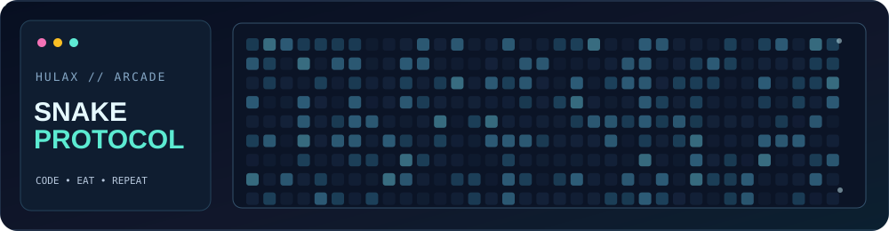

### AI Engineer · Data Scientist · Full-Stack Engineer

**[ABOUT](#-about-me)** &nbsp; · &nbsp; **[BUILDS](#-featured-projects)** &nbsp; · &nbsp; **[PLAY SNAKE](#-play-neural-snake)** &nbsp; · &nbsp; **[ACTIVITY](#-github-contributions)** &nbsp; · &nbsp; **[CONNECT](#lets-build-something-meaningful)**

---

## 👋 About me

I'm **Rahul Khanke**, a data scientist and software engineer building at the intersection of **applied AI, data engineering and thoughtful product development**. I enjoy owning the entire journey: designing the data flow, developing ML models and APIs, and translating complex results into intuitive interfaces.

- 🎓 **MSc Data Science**, University of Glasgow; **B.E. Computer Science**, G.H. Raisoni College of Engineering.
- 💼 Former **Custom Software Engineering Associate at Accenture** and **Cognizant intern**.
- 🧠 Interested in agentic AI, RAG, time-series forecasting, graph analytics, explainable ML and streaming systems.
- 🛠️ Working across Python, FastAPI, Kafka, SQL, TypeScript, React and Next.js.
- 🌐 For detailed case studies, visit [my interactive portfolio](https://portfolio.hulax.uk/).

## 🚀 Featured projects

<table>
<tr>
<td width="50%" valign="top">
<h3>🤖 <a href="https://github.com/HuLaxx/Sentinance">Sentinance</a></h3>

<b>AI-powered market intelligence</b> Multi-exchange market streams, LangGraph agents, retrieval-augmented insights and LSTM forecasting.

<code>Python</code> <code>FastAPI</code> <code>LangGraph</code> <code>PyTorch</code> <code>Next.js</code>

<a href="https://github.com/HuLaxx/Sentinance">Explore source</a> · <a href="https://sentinance.vercel.app">Project website</a>
</td>
<td width="50%" valign="top">
<h3>🛡️ <a href="https://github.com/HuLaxx/GraphGuard">GraphGuard</a></h3>

<b>Explainable fraud analytics</b> Graph-driven fraud detection, XGBoost risk models, SHAP explainability and GraphQL-powered exploration.

<code>Neo4j</code> <code>XGBoost</code> <code>SHAP</code> <code>GraphQL</code> <code>Python</code>

<a href="https://github.com/HuLaxx/GraphGuard">Explore source</a> · <a href="https://graph-guard-frontend.vercel.app">Project website</a>
</td>
</tr>
<tr>
<td width="50%" valign="top">
<h3>🚚 <a href="https://github.com/HuLaxx/FleetFlow">FleetFlow</a></h3>

<b>Reactive delivery optimization</b> Vehicle routing with OR-Tools, live fleet visualization and event-driven logistics architecture.

<code>OR-Tools</code> <code>Kafka</code> <code>PostGIS</code> <code>Next.js</code> <code>Python</code>

<a href="https://github.com/HuLaxx/FleetFlow">Explore source</a> · <a href="https://fleet-flow-rho.vercel.app">Project website</a>
</td>
<td width="50%" valign="top">
<h3>🎵 <a href="https://github.com/HuLaxx/Shiftify">Shiftify</a></h3>

<b>Privacy-first music library utility</b> Browser-first YouTube Music export experience with a polished responsive interface.

<code>TypeScript</code> <code>Next.js</code> <code>Tailwind CSS</code>

<a href="https://github.com/HuLaxx/Shiftify">Explore source</a> · <a href="https://shiftifymusic.vercel.app">Project website</a>
</td>
</tr>
</table>

### More from my workspace

**[Interactive portfolio](https://github.com/HuLaxx/my-portfolio)** · **[Xchange](https://github.com/HuLaxx/Xchange)** (textbook exchange) · **[TestVeh](https://github.com/HuLaxx/TestVeh)** (Django and React) · **[Calendar in C](https://github.com/HuLaxx/Calendar-In-C)** · **[BCPD](https://github.com/HuLaxx/BCPD)** (Bayesian change-point detection research repository)

## 🧰 Technical toolkit

| Focus | Technologies |
| --- | --- |
| **AI & machine learning** | Python, PyTorch, XGBoost, SHAP, LangGraph, RAG, LSTM, time-series analysis |
| **Data & backend** | SQL, FastAPI, PostgreSQL, Neo4j, Kafka, Airflow, Redis, GraphQL |
| **Web experiences** | Next.js, React, TypeScript, Tailwind CSS, Three.js, Framer Motion |
| **Infrastructure** | Docker, Kubernetes, AWS, CI/CD, API design, observability |

## 🕹️ Play Neural Snake

### 🎮 An Easter egg you can actually play

**Arrow keys / WASD** to move · **Space** to pause · **Touch controls** on mobile

A tiny interactive experiment with real game rules, collision detection, score tracking, a local best score and an increasingly fast snake.

**[▶ Launch the arcade](https://portfolio.hulax.uk/arcade)** &nbsp; · &nbsp; [View the game source](https://github.com/HuLaxx/my-portfolio/tree/master/src/app/arcade)

The artwork above is an original looping arcade illustration; the actual game opens in the browser.

## 🧭 Engineering approach

I care about **evidence-backed engineering, reproducible experiments and readable systems**. A convincing project is more than a demo: it should explain its data flow, trade-offs, architecture and what is truly running. Some of my project websites offer lighter hosted experiences, while the full infrastructure is documented for local execution.

## 🐍 GitHub contributions

<picture>
  <source media="(prefers-color-scheme: dark)" srcset="https://raw.githubusercontent.com/HuLaxx/HuLaxx/output/github-contribution-grid-snake-dark.svg" />
  <source media="(prefers-color-scheme: light)" srcset="https://raw.githubusercontent.com/HuLaxx/HuLaxx/output/github-contribution-grid-snake.svg" />
  
</picture>

Neon snake preview is visible immediately. A scheduled GitHub Action replaces it with a contribution-based animation after a successful run.

---

### Let's build something meaningful

Interested in **applied AI, data platforms or thoughtful digital products**?

[**Portfolio**](https://portfolio.hulax.uk/) · [**LinkedIn**](https://www.linkedin.com/in/rahul-khanke-853717218/) · [**Email**](mailto:rahulkhanke786@gmail.com)

Made with curiosity, code and attention to detail.

